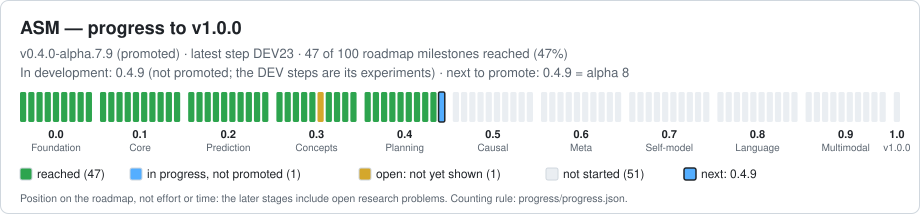
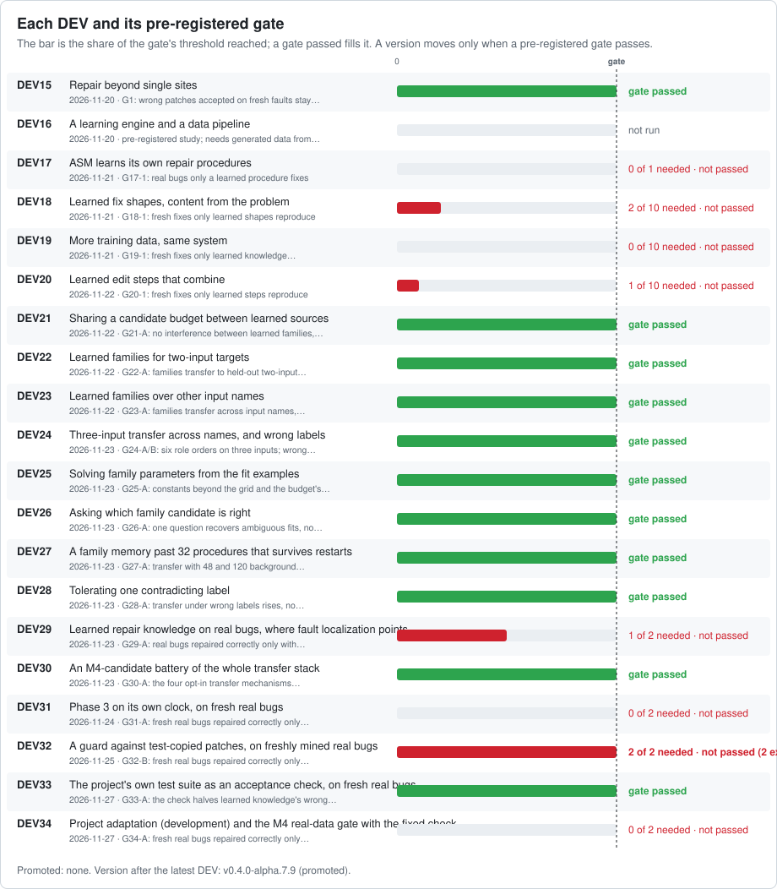

# Fantasia

<!-- progress:start -->
<!-- generated by progress/make_progress.py from progress/progress.json and ROADMAP.md; do not edit by hand -->
## Progress to v1.0.0

**v0.4.0-alpha.7.9 (promoted) · latest step DEV28 · 47 of 100 roadmap milestones reached (47%)**

`████████████████████████▓░░░░░░░░░░░░░░░░░░░░░░░░░` 47%

- Reached: 47 (0.0.1–0.4.8: up to the last promoted release, v0.4.0-alpha.7.9 (alpha 7.8 delivered 0.4.7 and 0.4.8); alpha 8 = 0.4.9 (project owner); except those listed as open).
- In development: 0.4.9 (not promoted; the DEV steps are its experiments). Next to promote: **0.4.9 = alpha 8**.
- Open: 0.3.5, generalization to unseen data is not yet shown (ROADMAP.md).
- Not started: 51 (everything after 0.4.9).
- Alpha 8 plan toward M4 — Generalizing Research AI: 0 of 9 targets validated (DEV21–DEV28 each passed held-out gates in a lab (DEV24 and DEV28 also with wrong labels); three family mechanisms are defaults); what exists for each: [ROADMAP.md](ROADMAP.md#release-governance-and-the-alpha-8-plan).

| DEV | date | pre-registered gate | result | promoted |
|---|---|---|---|---|
| [DEV28](asm_alpha8/ALPHA8_CODING_DEV28_IMPLEMENTATION.md) Tolerating one contradicting label | 2026-11-23 | G28-A: transfer under wrong labels rises, no wrong answer, held out | passed: wrong labels at 0.05 0.102 → 0.579, at 0.10 0.009 → 0.181 (168 vs 0 paired), clean 0.999 → 0.986, no false transfer, no wrong answer | no |
| [DEV27](asm_alpha8/ALPHA8_CODING_DEV27_IMPLEMENTATION.md) A family memory past 32 procedures that survives restarts | 2026-11-23 | G27-A: transfer with 48 and 120 background procedures and after a restart, held out | passed: relevant donors 0.000 → 1.000 with 48 and 120 background procedures (288 vs 0 paired each), unchanged after reopening, no false transfer, no wrong answer | no |
| [DEV26](asm_alpha8/ALPHA8_CODING_DEV26_IMPLEMENTATION.md) Asking which family candidate is right | 2026-11-23 | G26-A: one question recovers ambiguous fits, no loss, held out | passed: degenerate fits 0.817 → 0.991 (150 vs 0 paired), standard fits 0.984 → 1.000, role order no longer matters, 0.03 questions per ordinary attempt, no wrong answer | no |
| [DEV25](asm_alpha8/ALPHA8_CODING_DEV25_IMPLEMENTATION.md) Solving family parameters from the fit examples | 2026-11-23 | G25-A: constants beyond the grid and the budget's reach, no loss, held out | passed: beyond the −8..8 grid 0.000 → 0.982 (212 vs 0 paired), beyond the budget's reach 0.000 → 1.000 (54 vs 0), no loss, half the evaluator calls, no wrong answer | no |
| [DEV24](asm_alpha8/ALPHA8_CODING_DEV24_IMPLEMENTATION.md) Three-input transfer across names, and wrong labels | 2026-11-23 | G24-A/B: six role orders on three inputs; wrong labels cost only their own attempts | passed: donors over other names 0.000 → 0.979 on 3 new three-input structures, all six role orders (846 vs 0 paired); labels wrong at 0.10 cost exactly the corrupted attempts; no wrong answer | no |
| [DEV23](asm_alpha8/ALPHA8_CODING_DEV23_IMPLEMENTATION.md) Learned families over other input names | 2026-11-22 | G23-A: families transfer across input names, either role order, held out | passed: donors over other names 0.021 → 0.990 on 3 new two-input structures (279 vs 0 paired), both role orders, no wrong answer, no loss on exact-name or affine targets | no |
| [DEV22](asm_alpha8/ALPHA8_CODING_DEV22_IMPLEMENTATION.md) Learned families for two-input targets | 2026-11-22 | G22-A: families transfer to held-out two-input tasks | passed: relevant donors 0.229 → 0.993 on 3 new two-input structures (110 vs 0 paired), no wrong answer, no loss on affine targets | no |
| [DEV21](asm_alpha8/ALPHA8_CODING_DEV21_IMPLEMENTATION.md) Sharing a candidate budget between learned sources | 2026-11-22 | G21-A: no interference between learned families, held out | passed: relevant + unrelated donors 0.000 → 1.000 on 3 new structures (144 paired attempts, no wrong answer); Part B on learned steps not passed (2 gained, 0 lost) | no |
| [DEV20](asm_alpha8/ALPHA8_CODING_DEV20_IMPLEMENTATION.md) Learned edit steps that combine | 2026-11-22 | G20-1: fresh fixes only learned steps reproduce | 1 of 10 needed · not passed (of 483) | no |
| [DEV19](asm_alpha8/ALPHA8_CODING_DEV19_IMPLEMENTATION.md) More training data, same system | 2026-11-21 | G19-1: fresh fixes only learned knowledge reproduces | 0 of 10 needed · not passed (of 103) | no |
| [DEV18](asm_alpha8/ALPHA8_CODING_DEV18_IMPLEMENTATION.md) Learned fix shapes, content from the problem | 2026-11-21 | G18-1: fresh fixes only learned shapes reproduce | 2 of 10 needed · not passed (of 472) | no |
| [DEV17](asm_alpha8/ALPHA8_CODING_DEV17_IMPLEMENTATION.md) ASM learns its own repair procedures | 2026-11-21 | G17-1: real bugs only a learned procedure fixes | 0 of 1 needed · not passed (of 59) | no |
| [DEV16](asm_alpha8/ALPHA8_CODING_DEV16_IMPLEMENTATION.md) A learning engine and a data pipeline | 2026-11-20 | pre-registered study; needs generated data from the user's PC | not run yet | no |
| [DEV15](asm_alpha8/ALPHA8_CODING_DEV15_IMPLEMENTATION.md) Repair beyond single sites | 2026-11-20 | G1: wrong patches accepted on fresh faults stay within the bound | passed: 0 of 18 accepted patches wrong; real bugs: 4 of 83 repaired correctly | no |

This is a position on the roadmap, not effort or time: milestones are not equal work, and several later stages are open research problems ([ROADMAP.md](ROADMAP.md)). Updated after every DEV step.
<!-- progress:end -->
